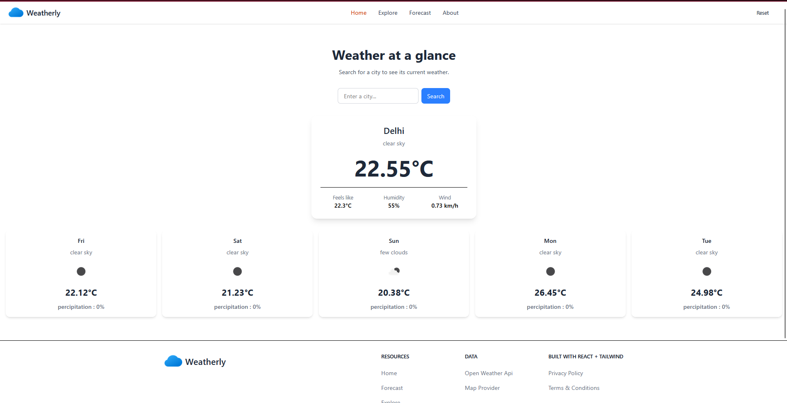
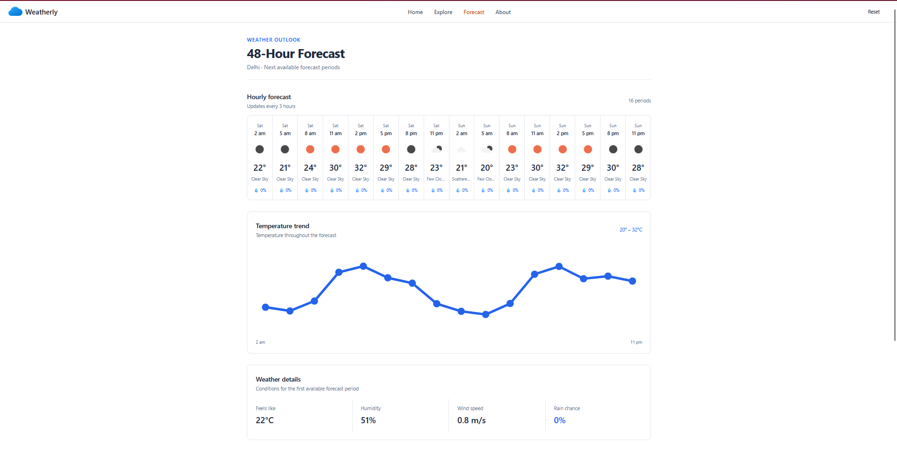
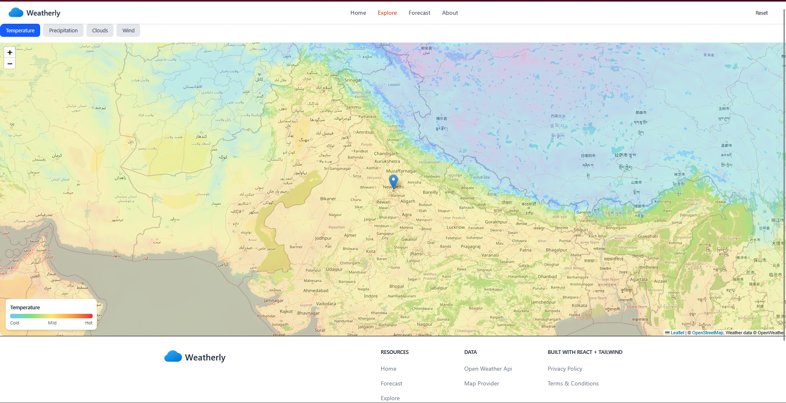
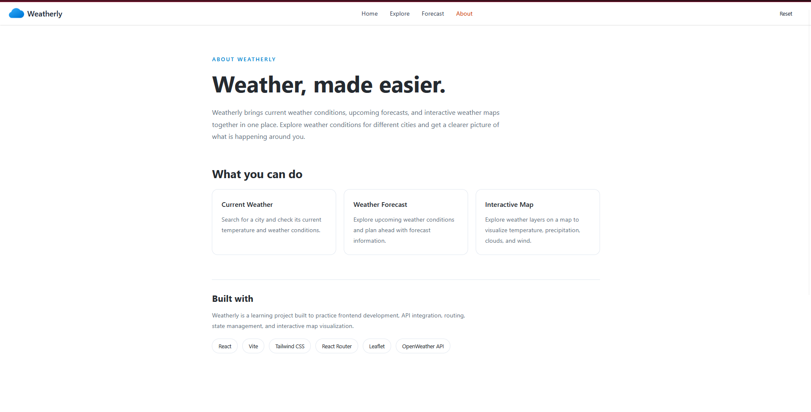

# Weatherly 🌦️

A weather application built with React that lets users search for cities, view current weather conditions, explore forecasts, and locate weather information on an interactive map.

## Features

- **Current Weather:** Search for a city and view its current weather conditions.
- **Forecast:** Explore upcoming weather forecasts.
- **Interactive Map:** View the searched location on a map with weather map overlays.
- **Explore:** Discover weather information through the map interface.
- **Error Handling:** Display appropriate errors for invalid cities and API failures.
- **Reset:** Clear the current weather search and return to the initial state.
- **Responsive Design:** Designed to work across desktop, tablet, and mobile screens.

## Tech Stack

- React
- Vite
- JavaScript
- Tailwind CSS
- React Router
- React Leaflet and Leaflet
- OpenWeather API

## Getting Started

### Prerequisites

- Node.js and npm
- An OpenWeather API key

### Installation

1. Clone the repository:

   ```bash
   git clone https://github.com/snaxx05/Weatherly.git
   ```

2. Navigate into the project directory:

   ```bash
   cd weather-app
   ```

3. Install dependencies:

   ```bash
   npm install
   ```

4. Create a `.env` file in the project root and add your API key:

   ```env
   VITE_WEATHER_API_KEY=your_api_key_here
   ```

5. Start the development server:

   ```bash
   npm run dev
   ```

6. Open the local URL shown in your terminal.

## Environment Variables

| Variable | Description |
|---|---|
| `VITE_WEATHER_API_KEY` | API key used to retrieve weather data from OpenWeather |

Never commit your actual API key to the repository.

## Live Demo

[View Weatherly](https://weather-app-v2-nu.vercel.app/)


## Screenshots

### Home


### Forecast


### Explore


### About 


## Author

**Sankalp Raj**

GitHub: https://github.com/snaxx05
